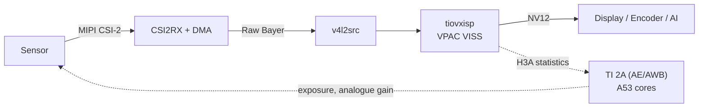

<Tip>
By the end of this section, you will have learned about the following topics.

* What the Camera ISP SDK does and where it fits into TI's Edge AI stack
* Which hardware blocks an image passes through from the sensor to the display
* Which camera sensors are supported
</Tip>

## 1. What is the Camera ISP SDK?

The TI AM67A (J722S) processor of the T3 Gemstone O1 has a hardware ISP (Image Signal Processor) called
**VPAC3L VISS**. From the sensor's raw Bayer data it produces a usable image: black level correction, demosaicing,
colour correction, gamma, noise filtering and the statistics for auto exposure and white balance. Doing this on
the CPU keeps almost three cores busy at 1080p; the hardware ISP does the same work on its own.

In TI's Edge AI 11.0 stack the ISP is reached through the `tiovxisp` GStreamer element. That element only works
with the sensors TI knows about (IMX219, IMX390, AR0233, AR0820, OV2312, OX05B1S): the tuning file ID, the auto
exposure limits and the exposure/gain conversions are picked in code by the `sensor-name` value. For any other
sensor the ISP runs on defaults and the image is unusable.

The **Camera ISP SDK** makes that path data-driven. A sensor is a directory under `sensors/`:

```
sensors/ov5647/
├── sensor.conf      descriptor: mode, CSI-2 link, DCC ID, AE limits, exposure/gain model
├── overlay.dtsi     device tree fragment, written once for both camera ports
├── dcc/linear/      ISP tuning sources (XML), compiled into dcc_*.bin
└── driver/          kernel module, for sensors whose driver is not in the kernel
```

A patch applied once to TI's GStreamer plugin makes `tiovxisp` and `tiovxldc` read `sensor.conf` at run time.
Adding a sensor needs no TI rebuild: no plugin patch, no R5F/C7x firmware, no `libtivision_apps`.

## 2. How It Works



Black level, demosaicing, colour matrix, gamma, noise filtering and statistics run in the VISS hardware. Only
the auto exposure and white balance loop (TI 2A) runs on the CPU; capture and ISP together take about 0.1 core.
The exposure and gain the 2A computes are converted to the sensor's `V4L2_CID_EXPOSURE` and
`V4L2_CID_ANALOGUE_GAIN` controls with the models in the descriptor.

## 3. Supported Sensors

| ID | Module | Kernel driver | Default mode | Status |
|----|--------|---------------|--------------|--------|
| `imx219` | Raspberry Pi Camera v2 | Mainline `imx219` | 1920x1080@30 RAW10 | Supported |
| `imx230` | Arducam Pivariety IMX230 | `arducam-pivariety` | 1920x1080@30 RAW10 | Supported |
| `imx477` | Raspberry Pi HQ Camera | Driver shipped with the Camera ISP SDK | 1920x1080@50 RAW12 | Experimental |
| `ov5647` | Raspberry Pi Camera v1.3 | Mainline `ov5647` (`kernel-module-ov5647` package) | 1920x1080@30 RAW10 | Supported |

* **Supported:** verified end to end on a board.
* **Experimental:** builds and passes all checks, not yet run on a board.

Notes for each sensor are on the [Supported Sensors](/en/boards/o1/isp/sensors) page.

<Note>
`imx219` is the reference sensor. Since TI supports it, running the same module once with `sensor-name=imx219`
(the Camera ISP SDK path) and once with `sensor-name=SENSOR_SONY_IMX219_RPI` (TI's path) checks the patched plugin
against a known-good tuning.
</Note>

## 4. Repository Layout

| Directory | Contents |
|-----------|----------|
| `sensors/` | One directory per sensor; `_template/` is used by `camera-isp-sdk new` |
| `boards/t3-gem-o1/` | Camera port headers (CSI0, CSI1), shared overlay plumbing, capture limits |
| `gst/` | `tiovxisp`/`tiovxldc` patch, descriptor parser and the on-board build script |
| `tools/camera_isp_sdk/` | The `camera-isp-sdk` tool (Python standard library only) |
| `docs/` | Architecture, descriptor reference, adding a sensor and ISP tuning |
| `Taskfile.yml` | Build tasks for the host computer |

## 5. Limitations

* Pinned to TI Edge AI SDK 11.0. TI dropped `tiovxisp` from J722S builds after 11.0; moving to a newer SDK
  means carrying that element too.
* Sensors on a direct CSI-2 link only; FPD-Link/GMSL serializers are not configured by `camera-isp-sdk setup`.
* One sensor mode per descriptor. Another mode needs its own H3A statistics grid and usually its own tuning.

<CardGroup cols={2}>
  <Card title="Building" icon="hammer" href="/en/boards/o1/isp/build">
    Build the Camera ISP SDK package on your computer.
  </Card>
  <Card title="Installation" icon="microchip" href="/en/boards/o1/isp/installation">
    Install the package on the board and configure the camera.
  </Card>
  <Card title="Usage" icon="video" href="/en/boards/o1/isp/usage">
    Send the camera through the hardware ISP to a display, a file or your own application.
  </Card>
  <Card title="Adding a Sensor" icon="plus" href="/en/boards/o1/isp/adding-a-sensor">
    Add your own camera sensor as a descriptor.
  </Card>
</CardGroup>
