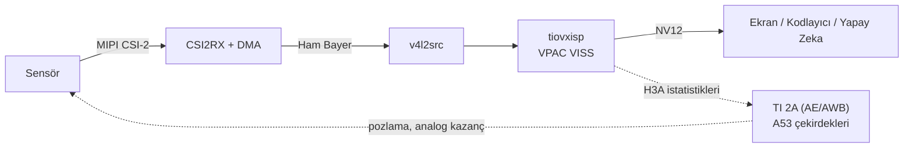

<Tip>
Bölüm bitiminde aşağıdaki konularda bilgi sahibi olacaksınız.

* Kamera ISP SDK'nin ne işe yaradığı ve TI Edge AI yığınının neresine eklendiği
* Görüntünün sensörden ekrana kadar hangi donanım bloklarından geçtiği
* Hangi kamera sensörlerinin desteklendiği
</Tip>

## 1. Kamera ISP SDK Nedir?

T3 Gemstone O1 kartındaki TI AM67A (J722S) işlemcisinde **VPAC3L VISS** isimli bir donanım ISP'si
(Image Signal Processor) bulunur. ISP; sensörden gelen ham Bayer verisinden siyah seviyesi düzeltme, demozaik,
renk düzeltme, gamma, gürültü filtresi ve otomatik pozlama/beyaz dengesi istatistikleri gibi işlemlerle
kullanılabilir bir görüntü üretir. Bu işlemlerin CPU üzerinde yapılması 1080p görüntüde neredeyse üç çekirdeği
meşgul ederken, donanım ISP'si aynı işi kendi başına yapar.

TI'nin Edge AI 11.0 yazılım yığınında ISP'ye `tiovxisp` GStreamer elemanı üzerinden erişilir. Ancak bu eleman
yalnızca TI'nin tanıdığı sensörlerle (IMX219, IMX390, AR0233, AR0820, OV2312, OX05B1S) çalışır: ayar dosyası
kimliği, otomatik pozlama sınırları ve pozlama/kazanç dönüşümleri `sensor-name` değerine göre kodun içinde
seçilir. Listede olmayan bir sensörde ISP varsayılan değerlerle çalışır ve görüntü kullanılamaz hale gelir.

**Kamera ISP SDK** bu yolu veriye dayalı hale getirir. Bir sensör, `sensors/` altında bir dizinden ibarettir:

```
sensors/ov5647/
├── sensor.conf      tanımlayıcı: mod, CSI-2 bağlantısı, DCC kimliği, AE sınırları, pozlama/kazanç modeli
├── overlay.dtsi     device tree parçası, her iki kamera portu için bir kez yazılır
├── dcc/linear/      ISP ayar kaynakları (XML), dcc_*.bin dosyalarına derlenir
└── driver/          çekirdekte sürücüsü olmayan sensörler için çekirdek modülü
```

TI'nin GStreamer eklentisine bir kez uygulanan bir yama, `tiovxisp` ve `tiovxldc` elemanlarının `sensor.conf`
dosyasını çalışma anında okumasını sağlar. Yeni bir sensör eklemek için TI kodunu yeniden derlemek, R5F/C7x
yazılımlarını değiştirmek ya da `libtivision_apps` kütüphanesine dokunmak gerekmez.

## 2. Nasıl Çalışır?



Siyah seviyesi, demozaik, renk matrisi, gamma, gürültü filtresi ve istatistik toplama VISS donanımında yapılır.
CPU üzerinde yalnızca otomatik pozlama ve beyaz dengesi döngüsü (TI 2A) çalışır; yakalama ve ISP birlikte
yaklaşık 0,1 çekirdek kullanır. 2A'nın hesapladığı pozlama ve kazanç, tanımlayıcıdaki modellerle sensörün
`V4L2_CID_EXPOSURE` ve `V4L2_CID_ANALOGUE_GAIN` kontrollerine çevrilir.

## 3. Desteklenen Sensörler

| Kimlik | Modül | Çekirdek sürücüsü | Durum |
|--------|-------|-------------------|-------|
| `imx219` | Raspberry Pi Camera v2 | `kernel-module-imx219` | Destekleniyor |
| `imx230` | Arducam Pivariety IMX230 | `kernel-module-arducam-pivariety` | Destekleniyor |
| `imx477` | Raspberry Pi HQ Camera | Kamera ISP SDK ile gelen sürücü | Destekleniyor |
| `ov5647` | Raspberry Pi Camera v1.3 | `kernel-module-ov5647` | Destekleniyor |

* **Destekleniyor:** Kart üzerinde uçtan uca doğrulandı.
* **Deneysel:** Derleniyor ve tüm kontrollerden geçiyor, ancak henüz kartta çalıştırılmadı.

Sensörlere özgü notlar [Desteklenen Sensörler](/tr/boards/o1/isp/sensors) sayfasında yer almaktadır.

<Note>
`imx219` referans sensördür. TI bu sensörü desteklediği için aynı modül bir kez `sensor-name=imx219`
(Kamera ISP SDK yolu), bir kez `sensor-name=SENSOR_SONY_IMX219_RPI` (TI'nin yolu) ile çalıştırılarak yamalı eklenti
bilinen iyi bir ayarla karşılaştırılabilir.
</Note>

## 4. Depo Yapısı

| Dizin | İçerik |
|-------|--------|
| `sensors/` | Her sensör için bir dizin; `_template/`, `camera-isp-sdk new` komutunun şablonudur |
| `boards/t3-gem-o1/` | Kamera portu başlıkları (CSI0, CSI1), ortak overlay parçaları, yakalama sınırları |
| `gst/` | `tiovxisp`/`tiovxldc` yaması, tanımlayıcı ayrıştırıcısı ve kart üzerinde çalışan derleme betiği |
| `tools/camera_isp_sdk/` | `camera-isp-sdk` aracı (yalnızca Python standart kütüphanesi) |
| `docs/` | Mimari, tanımlayıcı başvurusu, sensör ekleme ve ISP ayarı belgeleri |
| `Taskfile.yml` | Bilgisayardaki derleme görevleri |

## 5. Kısıtlamalar

* TI Edge AI SDK 11.0'a sabitlenmiştir. TI, 11.0 sonrasında `tiovxisp` elemanını J722S derlemelerinden
  çıkarmıştır; daha yeni bir SDK'ya geçmek bu elemanı da taşımayı gerektirir.
* Yalnızca doğrudan CSI-2 ile bağlanan sensörler desteklenir; FPD-Link/GMSL dönüştürücüleri `camera-isp-sdk setup`
  tarafından yapılandırılmaz.
* Her tanımlayıcıda tek bir sensör modu bulunur. Başka bir mod, kendi H3A istatistik ızgarasını ve genellikle
  kendi ISP ayarını gerektirir.

<CardGroup cols={2}>
  <Card title="Derleme" icon="hammer" href="/tr/boards/o1/isp/build">
    Kamera ISP SDK paketini bilgisayarda derleyin.
  </Card>
  <Card title="Kurulum" icon="microchip" href="/tr/boards/o1/isp/installation">
    Paketi karta kurun ve kamerayı yapılandırın.
  </Card>
  <Card title="Kullanım" icon="video" href="/tr/boards/o1/isp/usage">
    Kamerayı donanım ISP'si üzerinden ekrana, dosyaya veya kendi uygulamanıza aktarın.
  </Card>
  <Card title="Yeni Sensör Ekleme" icon="plus" href="/tr/boards/o1/isp/adding-a-sensor">
    Kendi kamera sensörünüzü tanımlayıcı olarak ekleyin.
  </Card>
</CardGroup>
